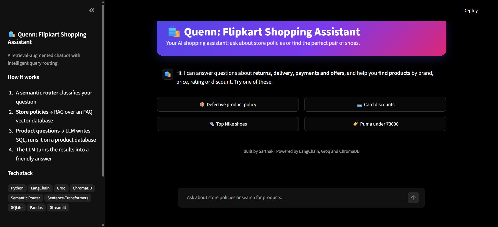
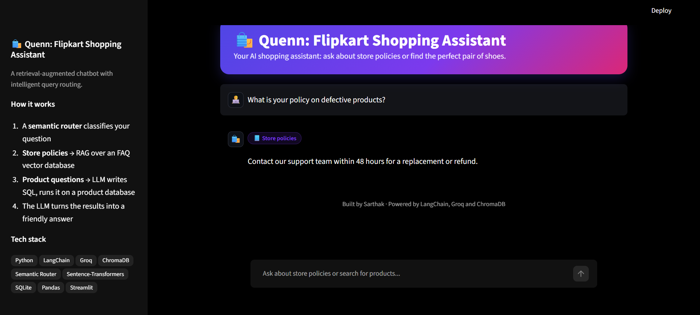
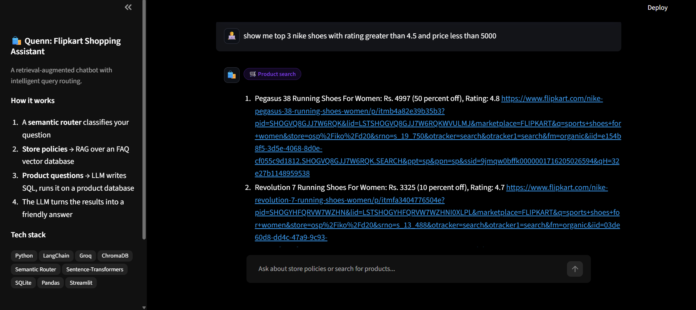
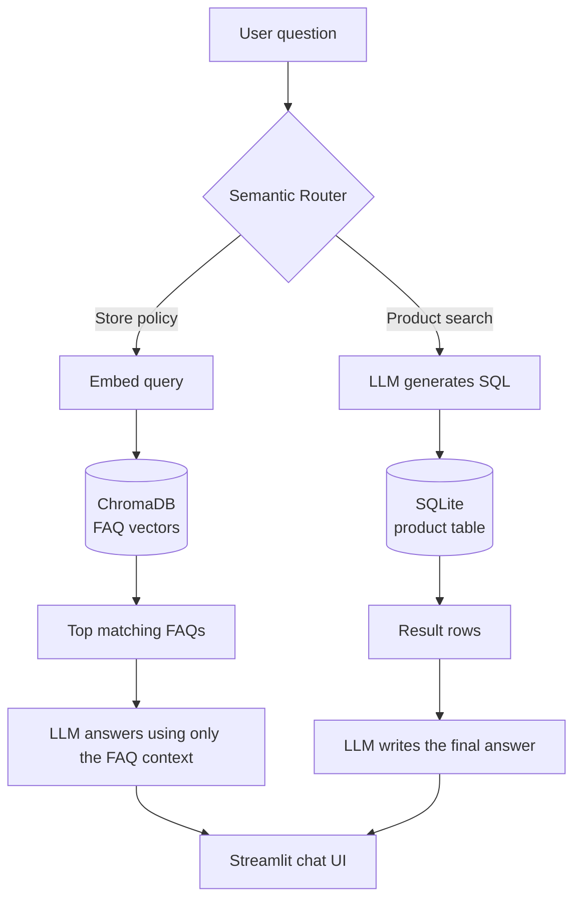

# 🛍️ Quenn: ShopAssist AI
 
An AI shopping assistant that answers **store-policy questions** using Retrieval-Augmented Generation (RAG) and **finds products** by turning natural language into SQL. A semantic router decides which path each question should take.
 
**🔗 Live demo:** 
<p align="center">
  
</p>
 
---
 
## ✨ Features
 
- **Semantic query routing:** each question is classified as a policy question (FAQ) or a product search, based on meaning rather than keywords.
- **FAQ answers with RAG:** questions are matched against an FAQ vector database (ChromaDB), and the LLM answers using only the retrieved entries, so it doesn't make up policies.

<p align="center">
  
</p>


- **Natural-language product search:** questions like *"Show me top 3 Nike shoes with rating higher than 4.5"* are converted to SQL, run on a product database, and summarized in plain English.

<p align="center">
  
</p>


- **Safe SQL execution:** only `SELECT` queries are executed, and results are capped before being sent back to the LLM.
- **Polished chat UI:** a Streamlit interface with example prompts, route badges on every answer, a typing effect, and a dark theme.
## 🧠 How it works
 

 
1. **Routing (`route.py`):** a `SemanticRouter` with a sentence-transformers encoder compares the question with example utterances for each route (`faq`, `sql`). If nothing matches, the question falls back to the FAQ chain, which says "I don't know" when the context has no answer.
2. **FAQ path (`faq.py`):** the FAQ CSV is embedded into ChromaDB. At query time, the most similar questions are retrieved, and their stored answers are passed to the LLM through a prompt that forbids answering beyond that context.
3. **Product path (`sql.py`):** the LLM receives the table schema and writes a SQL query, which is extracted, checked, and run on SQLite. The returned rows are given to the LLM again to produce a readable product list.
4. **UI (`main.py`):** a Streamlit chat app that loads the models once, keeps conversation history, and shows which route handled each answer.
## 🧰 Tech stack
 
| Area | Tools |
|---|---|
| Language | Python |
| LLM | Groq (`openai/gpt-oss-20b`) via LangChain |
| RAG / vector DB | LangChain, ChromaDB |
| Embeddings | Sentence-Transformers (Hugging Face) |
| Routing | Semantic Router |
| Product data | SQLite, Pandas |
| Front end | Streamlit |
| Tooling | uv |
 
## 📁 Project structure
 
```
e_commerce_chatbot/
├── app/
│   └── e_commerce_chatbot/
│       ├── main.py            # Streamlit app
│       ├── faq.py             # RAG pipeline (ChromaDB + LLM)
│       ├── route.py           # Semantic router (faq vs sql)
│       ├── sql.py             # Text-to-SQL pipeline
│       ├── db.sqlite          # Product database
│       └── resources/
│           └── faq_data.csv   # FAQ questions and answers
├── .streamlit/
│   └── config.toml            # Theme and server settings
├── requirements.txt           # Dependencies for Streamlit Cloud
├── pyproject.toml
└── README.md
```
 
## 🚀 Getting started
 
### Prerequisites
 
- Python 3.10 or newer
- [uv](https://docs.astral.sh/uv/) (or pip)
- A free [Groq API key](https://console.groq.com/keys)
### Run it locally
 
```bash
# 1. Clone the repository
git clone https://github.com/your-username/your-repo-name.git
cd your-repo-name
 
# 2. Install dependencies
uv sync
 
# 3. Add your API key
echo "GROQ_API_KEY=your_key_here" > .env
echo "GROQ_MODEL=openai/gpt-oss-20b" >> .env
 
# 4. Start the app
uv run streamlit run app/e_commerce_chatbot/main.py
```
 
The first run downloads the embedding models and builds the FAQ vector store automatically, so it can take a minute.
 
### Example questions
 
| Type | Try asking |
|---|---|
| Store policy | *What is your policy on defective products?* |
| Store policy | *On which card is there a discount, and how much is it?* |
| Product search | *Show me top 3 Nike shoes with rating higher than 4.5* |
| Product search | *Show me Puma shoes under Rs. 3000* |
 
## ☁️ Deploying to Streamlit Community Cloud
 
1. Push the repo to GitHub. Make sure `.env` is in `.gitignore` and **never committed**.
2. On [share.streamlit.io](https://share.streamlit.io), create a new app and set the main file path to `app/e_commerce_chatbot/main.py`.
3. Under **Advanced settings → Secrets**, add:
```toml
   GROQ_API_KEY = "your-key-here"
   GROQ_MODEL = "openai/gpt-oss-20b"
```
4. Deploy.
## ⚙️ Design decisions
 
- **Semantic routing instead of keyword rules:** it handles different phrasings of the same question and is easy to extend by adding example utterances for new routes.
- **Strict RAG prompt:** the assistant is told to answer only from the retrieved FAQ entries, which keeps policy answers faithful to the source data.
- **Capped results:** only a few rows go back to the LLM, which keeps responses fast and avoids token-limit errors on free-tier APIs.
- **Models loaded once:** embeddings and the vector store are cached, so only the first request pays the startup cost.
## 🔭 Limitations and future work
 
- The product catalog is a static SQLite file. A production version would connect to a live database.
- Conversation memory is not used for routing or answering, so each question is handled independently.
- The router only knows two routes. Order tracking, returns initiation and similar actions could become new routes.
- Add automated evaluation of routing accuracy and SQL correctness on a labeled question set.
## 👤 Author
 
**Sarthak**
